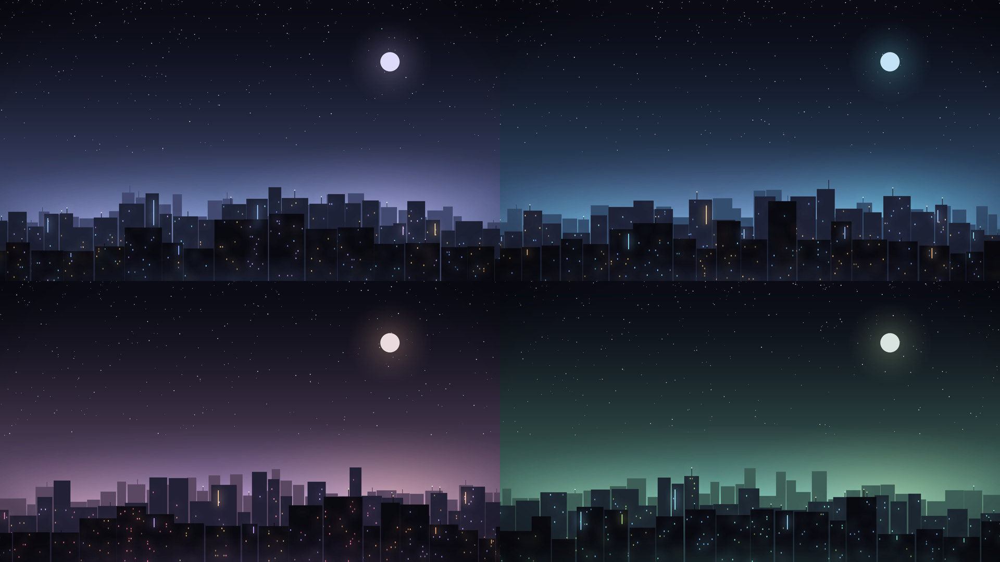

# Tokyo Night — KDE Plasma 6 paketi

Gece mavisi zemin, neon mavi/mor vurgular; gece şehri duvar kağıtları. Kubuntu 26.04 / Plasma 6.6 üzerinde hazırlandı ve denendi.



## Hızlı kurulum

```bash
git clone <bu-reponun-adresi> tokyo-night-kde   # ya da zip olarak indirip aç
cd tokyo-night-kde
bash kur.sh
```

`kur.sh` root istemez, değiştirdiği her ayarın yedeğini `~/.local/share/tokyo-night-kde-yedek/<tarih>` altına alır. Geri almak için betiğin sonunda yazdığı komutu çalıştır (`bash geri-al.sh <yedek-klasörü>`).

Kurduğu şeyler:

| Parça | Ne yapar |
|---|---|
| `renkler/TokyoNight.colors` | KDE renk düzeni (pencereler, menüler, panel, GTK uygulamaları) |
| Plasma teması `default` | Panel ve açılır menüler renk düzenine uyar |
| Breeze ayarı | Büyük gölge, ince çerçeve, başlık altı çizgisi yok |
| `kvantum/TokyoNight` | Kvantum teması — yuvarlak düğmeler/kutular (KvArcDark'tan Tokyo renkleriyle) |
| `terminal/` | Konsole ve Black Box renk düzenleri (Black Box: Tokyo Night *Storm* zemini, biraz daha gri) |
| `duvar-kagitlari/` | 4 adet 4K duvar kağıdı: mavi-mor (varsayılan), mavi, mor-turuncu, turkuaz; kilit ekranı da aynı |
| `simgeler/tokyo-baslat.svg` | Başlat menüsü için mavi-mor hilal simgesi |

**Kvantum** kurulu değilse betik stil kısmını atlar. Kurmak için (Ubuntu/Kubuntu):

```bash
sudo apt install qt-style-kvantum qt-style-kvantum-themes   # qt6-style-kvantum paketleri geçiş paketidir, çakışır
```

## İsteğe bağlı parçalar (`opsiyonel/`)

- **`komut-satiri.sh`** — tek satır komut satırı: `~/Projects/proje main ❯` (klasör mavi, git dalı mor, ok yeşil; son komut hata verdiyse ok kırmızı). `~/.bashrc` yedeğini alıp sonuna blok ekler. VTE/Black Box klasör takibini bozmaz.
- **`ada-paneller.sh`** — alttaki tek paneli 3 yüzen adaya böler (sol: başlat + masaüstleri, orta: görev çubuğu, sağ: tepsi + saat). Sabitlenmiş uygulamalar korunur. Panel ayar dosyasının yedeğini alır.
- **`panel-gizleme.sh`** — KWin betiği: büyütülmüş/tam ekran pencere varken **tüm** paneller birlikte gizlenir, fareyle alt kenara gelince açılır; yoksa görünür kalır. Ada panellerle kullanılmak için yazıldı (orta ada yer ayırır, yan adalar pencerelerden kaçar — Wayland'de üç panel birden yer ayırırsa orta panel yukarı itiliyor).

## Elle yapılacaklar

- **Konsole:** Ayarlar → Profili düzenle → Görünüm → *Tokyo Night*.
- **Black Box:** renk düzeni ancak program **tamamen** kapatılıp açılınca yüklenir.
- **Klasör rengi (Papirus kullanıyorsan):** [papirus-folders](https://github.com/PapirusDevelopmentTeam/papirus-folders) ile `papirus-folders -C indigo --theme Papirus-Dark`.
- **VS Code:** `enkia.tokyo-night` eklentisi → tema *Tokyo Night*.
- **Obsidian:** `obsidian/tokyo-night.css` dosyasını kasanın `.obsidian/snippets/` klasörüne koy → Ayarlar → Görünüm → CSS parçacıkları → *tokyo-night* aç (en iyi sonuç varsayılan temayla).
- **Firefox / Zen:** addons.mozilla.org'da "Tokyo Night" temalarından birini kur.
- **Giriş ekranı (SDDM):** duvar kağıdını root'un okuyabileceği bir yere (ör. `/usr/share/wallpapers/TokyoNight/`) kopyala ve tema klasöründeki `theme.conf.user` dosyasına `background=` satırı ekle.

## Duvar kağıdını yeniden üretmek

```bash
python3 duvar-kagidi-uret.py              # 3840x2160, hepsi
python3 duvar-kagidi-uret.py 2560 1440    # başka çözünürlük
ONLY=turkuaz python3 duvar-kagidi-uret.py # tek renk
```

Pillow gerekir (`sudo apt install python3-pil`). Renkler, şehir yoğunluğu ve rastgelelik tohumu `TEMALAR` sözlüğünde.

## Lisans / kaynaklar

- Renk paleti: [Tokyo Night](https://github.com/enkia/tokyo-night-vscode-theme) (enkia, MIT).
- Kvantum teması, Kvantum'un **KvArcDark** temasından türetildi (Tsu Jan, GPL-3.0); renkleri değiştirildi, lisansı aynen geçerli.
- Duvar kağıtları, simge, betikler ve renk dosyaları bu paket için üretildi; serbestçe kullan/değiştir.
